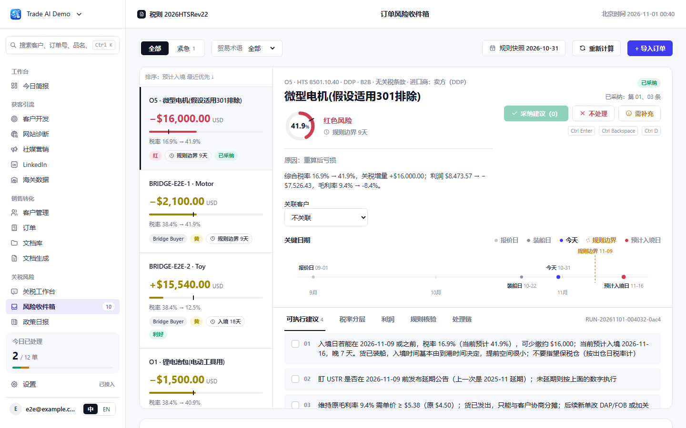
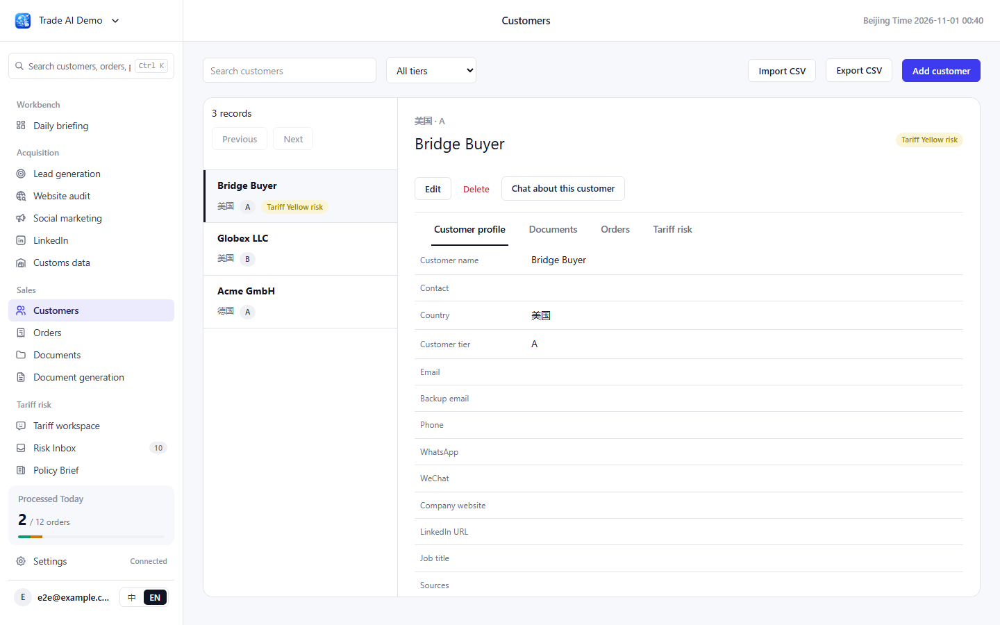
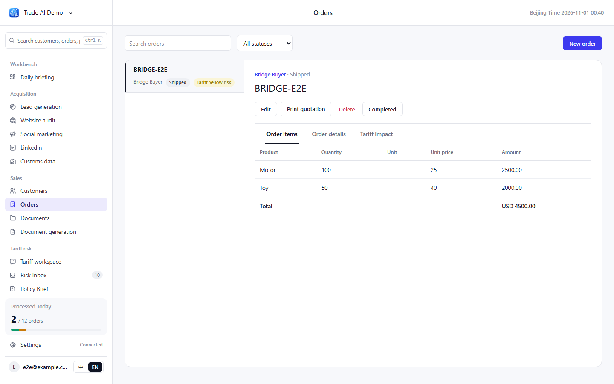

# Trade AI · Mariner v0.3 integration

[中文](README.md) | [English](README.en.md)

Smart Trade AI customer, order, document and business assistant workflows integrated with Mariner tariff risk analysis. **Every application page uses the Mariner v0.3 UI**, with Chinese and English language support.

**Application directory: [login-demo/](login-demo/). Entry point: `login-demo/app.py`. Full setup and configuration: [application guide](login-demo/README.md).**

## Screenshots

These screenshots were captured from the integrated application during browser acceptance tests. They use a temporary test account, sample customers and orders, and the fixed tariff date **2026-10-31**. Business screenshots use English; tariff screenshots use Chinese. A newly registered account has no business records, so its content and counts will differ. Change the interface language in the sidebar.

### Tariff risk inbox



### Customers and tariff risk



### Orders



[All integration screenshots](login-demo/artifacts/screenshots/) · [Acceptance record](docs/superpowers/2026-11-01-mariner-bridge-review.md)

## Run the integrated application

Requirements: Python 3.12+, Node.js 20.9+ (22 or 24 recommended), and npm. Open PowerShell at the repository root:

```powershell
cd login-demo
python -m venv .venv
.venv/Scripts/python -m pip install -r requirements.txt
./scripts/build-web.ps1
$env:TARIFF_COLLECTOR_MODE = 'fixture'
$env:TARIFF_AS_OF_DATE = '2026-10-31'
$env:TARIFF_SCHEDULER_ENABLED = 'false'
.venv/Scripts/python -m uvicorn app:app --host 127.0.0.1 --port 8017
```

Open **http://127.0.0.1:8017/** and register an account. FastAPI serves the exported Next.js frontend; no Node server is required in production. These commands enable local tariff fixtures. Business chat still requires a valid model key in Settings.

See the [application guide](login-demo/README.md) for development mode, Linux/macOS commands, live policy collection, model configuration, backups and tests.

The repository retains the upstream application. Root-level `server.py`, original installation scripts and `docs/screenshot-*.png` belong to legacy Smart Trade AI and do not launch or show this integration. Historical instructions are available in the [upstream documentation](https://github.com/wangdiaonb/smart-trade-ai/blob/b59f90c98e4b0f36a1be2acc26853d329e79fbcf/README.en.md).

## Verified scope

- 149 backend tests passed, covering tenant isolation, encrypted settings, tariff calculations and order conversion.
- 15 frontend unit tests and 36 browser tests passed.
- Original Mariner design tokens, tariff rules and golden data are preserved. Customer, order, tariff risk and chat consent workflows are connected.
- Real model providers, Tavily and Hermes were not verified with live accounts; automated tests use local fixtures and mocks.

## License and attribution

This project uses [AGPL-3.0](LICENSE). Business workflows originate from [Smart Trade AI](https://github.com/wangdiaonb/smart-trade-ai); tariff analysis and UI originate from [Mariner AI](https://github.com/1553784768/mariner-ai). Mariner MIT notices remain in the [backend](login-demo/mariner/LICENSE-MARINER) and [frontend](login-demo/web/LICENSE-MARINER).
