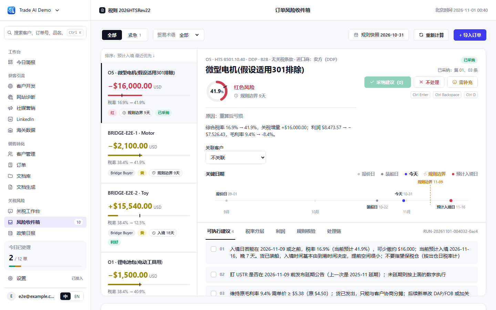
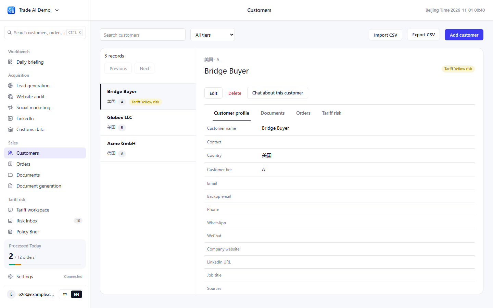
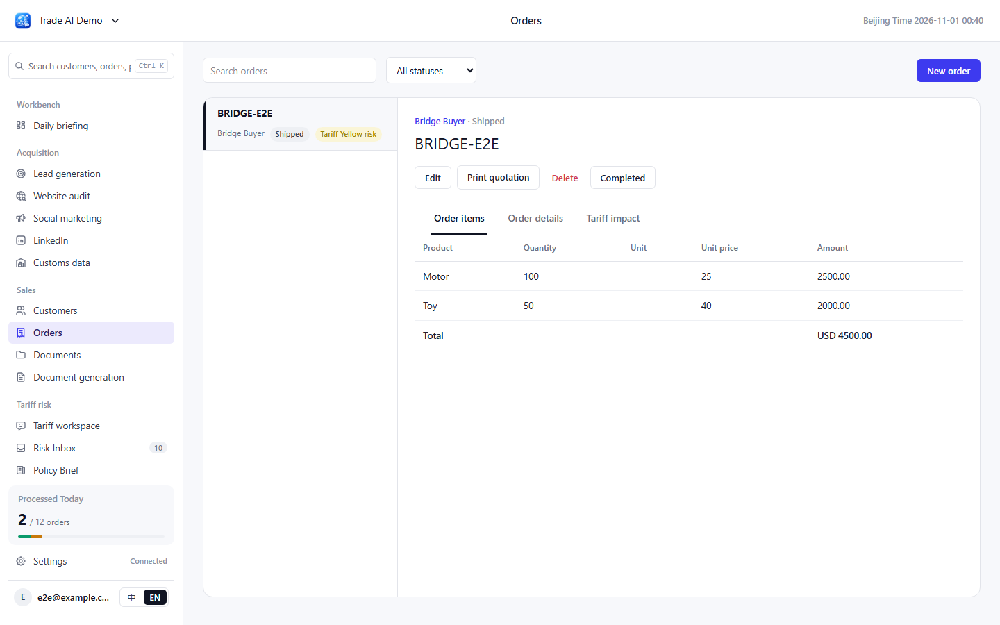

# Trade AI · Mariner v0.3 融合版

[中文](README.md) | [English](README.en.md)

将 Smart Trade AI 的客户、订单、文档和业务智能体，与 Mariner 的关税风险分析融合为一个应用。**全部页面采用 Mariner v0.3 UI**，支持中文和英文。

**应用目录：[login-demo/](login-demo/)。启动入口：`login-demo/app.py`。完整安装与配置：[使用说明](login-demo/README.md)。**

## 界面预览

以下图片来自本仓库融合版的浏览器验收，位于 `login-demo/artifacts/screenshots/bridge-*.png`。截图使用临时测试账号、示例客户与订单、固定关税日期 **2026-10-31**；业务页面截图为英文，关税页面为中文。新注册账号的业务数据为空，首次使用的内容和统计不会与截图完全一致，可在侧栏切换语言。

### 关税风险收件箱



### 客户管理与关税风险



### 订单管理



[查看全部融合版截图](login-demo/artifacts/screenshots/) · [验收记录](docs/superpowers/2026-11-01-mariner-bridge-review.md)

## 启动融合版

需要 Python 3.12+、Node.js 20.9+（建议 22 或 24）和 npm。在仓库根目录打开 PowerShell，执行：

```powershell
cd login-demo
python -m venv .venv
.venv/Scripts/python -m pip install -r requirements.txt
./scripts/build-web.ps1
$env:TARIFF_COLLECTOR_MODE = 'fixture'
$env:TARIFF_AS_OF_DATE = '2026-10-31'
$env:TARIFF_SCHEDULER_ENABLED = 'false'
.venv/Scripts/python -m uvicorn app:app --host 127.0.0.1 --port 8017
```

打开 **http://127.0.0.1:8017/** 并注册账号。生产运行只需 FastAPI，Next.js 前端已静态导出。上述命令使用本地关税演示数据；业务对话仍需在设置中配置有效模型 Key。

开发启动、Linux/macOS 命令、真实政策采集、模型设置、数据备份与测试方法，见 [login-demo/README.md](login-demo/README.md)。

仓库保留了上游原应用：根目录的 `server.py`、旧安装脚本及 `docs/screenshot-*.png` 属于旧版 Smart Trade AI，不能用于启动或展示本融合版。其历史使用方法可查阅 [上游原版文档](https://github.com/wangdiaonb/smart-trade-ai/blob/b59f90c98e4b0f36a1be2acc26853d329e79fbcf/README.md)。

## 已验证的范围

- 后端：149 项测试通过，包含租户隔离、加密配置、关税计算与订单转换。
- 前端：15 项单元测试、36 项浏览器测试通过。
- 保留 Mariner 原始样式 token、税率规则和 golden 数据；统一客户、订单、关税风险和聊天授权流程。
- 真实外部模型、Tavily 和 Hermes 服务未使用真实账号验收；自动化测试采用本地夹具和模拟服务。

## 许可与来源

项目沿用 [AGPL-3.0](LICENSE)。业务功能来自 [Smart Trade AI](https://github.com/wangdiaonb/smart-trade-ai)，关税模块与 UI 来自 [Mariner AI](https://github.com/1553784768/mariner-ai)。Mariner 的 MIT 许可声明保留于 [后端](login-demo/mariner/LICENSE-MARINER) 和 [前端](login-demo/web/LICENSE-MARINER)。
